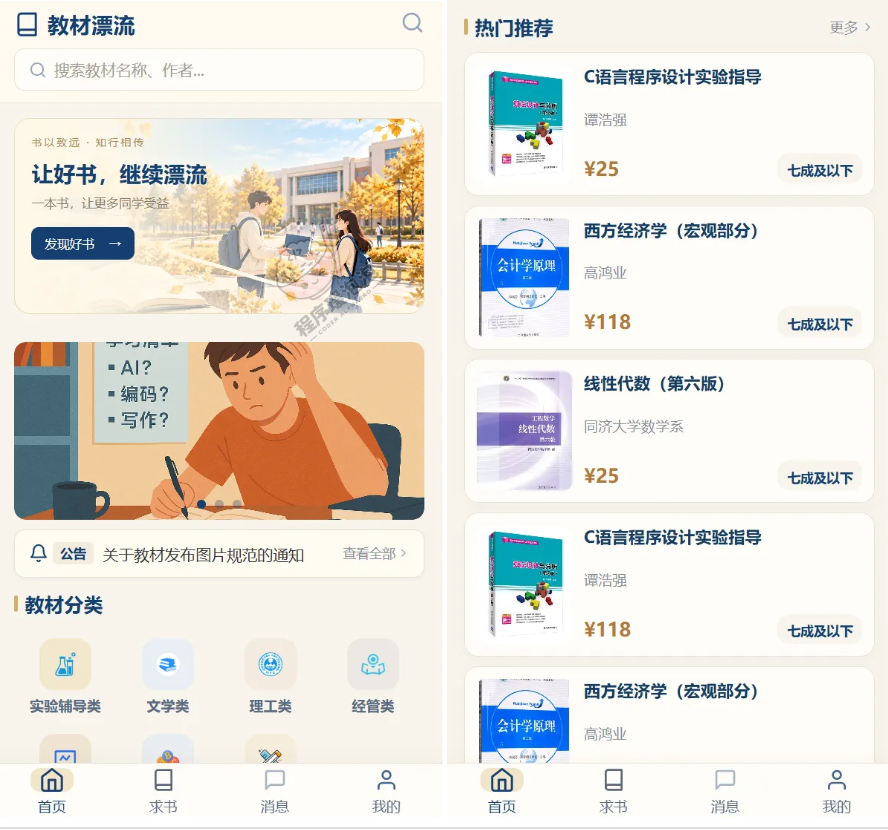
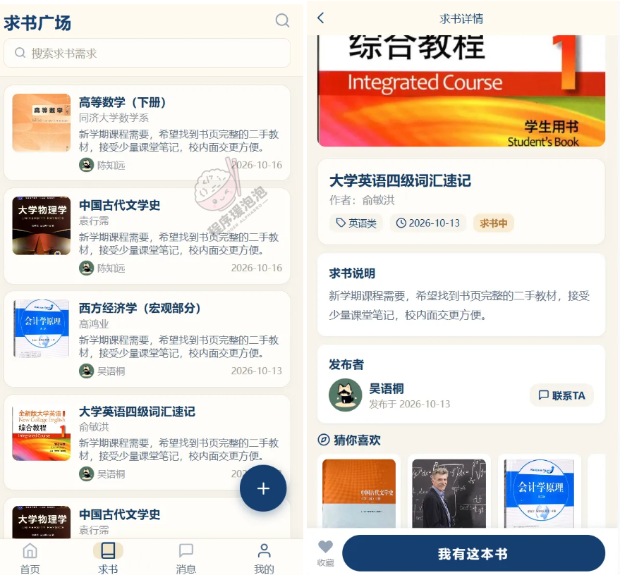
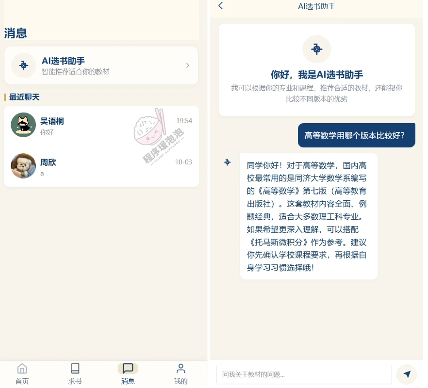
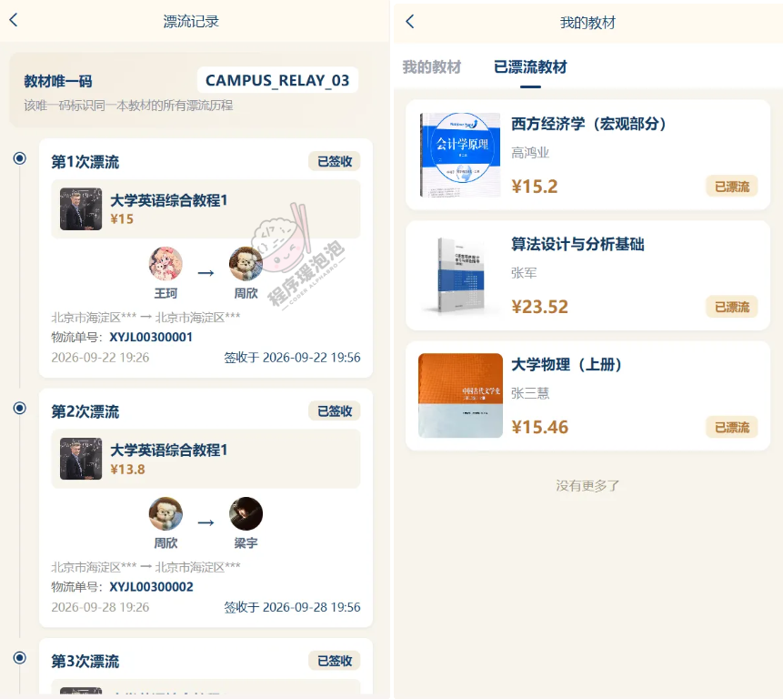
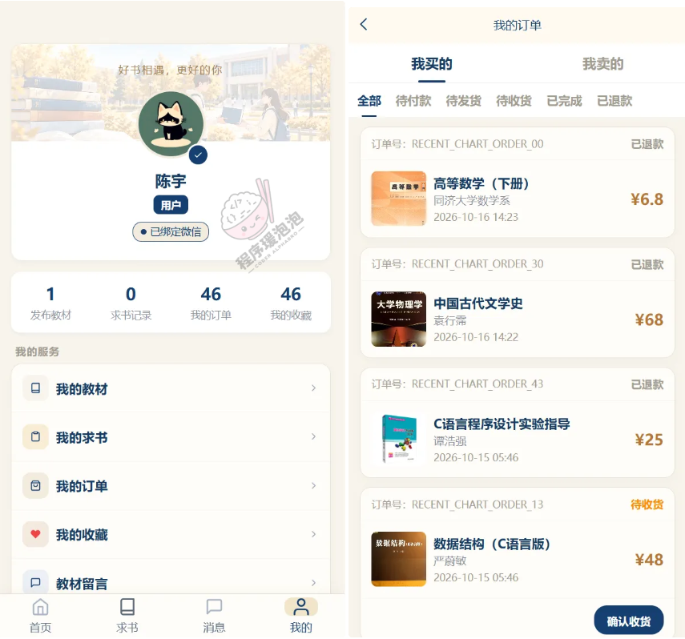
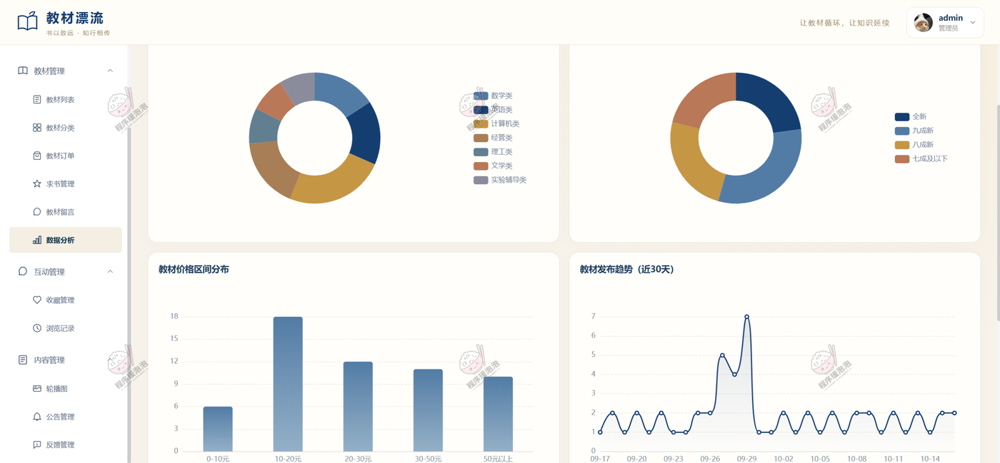
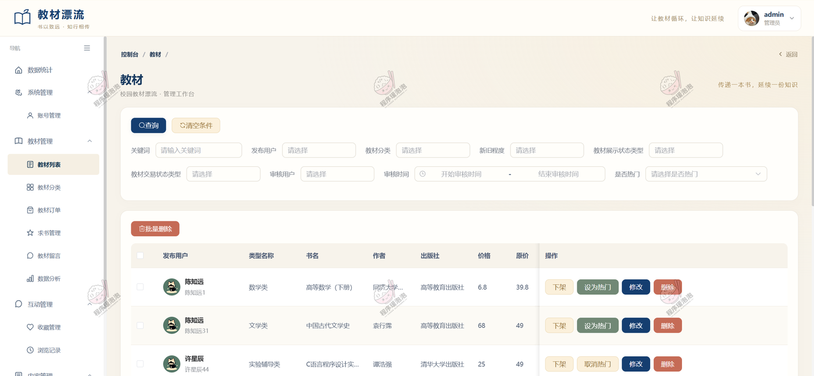
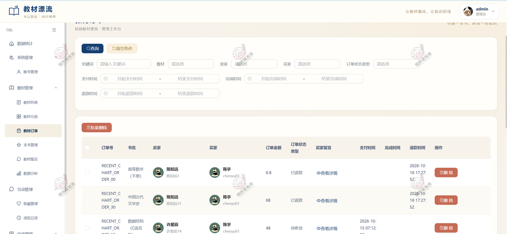
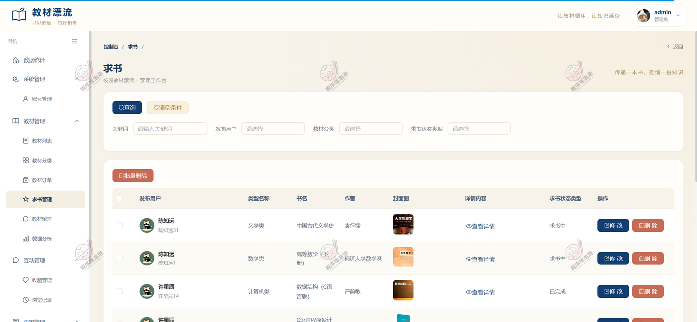
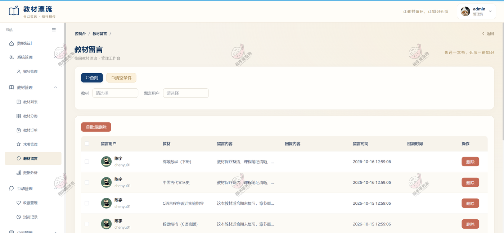

# CollegeIdleTeachingMaterialsDrifting
大学生闲置教材漂流微信小程序
亮点：AI选书问答与关联推荐、协同过滤教材推荐、教材循环漂流、WebSocket实时沟通、 中文分词词云、ECharts数据可视化、腾讯地图组件、交易状态与超时处理
角色：用户、管理员；
数据库：17张；

# 大学生闲置教材漂流微信小程序

> 基于 Spring Boot 3 + uni-app + DeepSeek 的教材循环平台，微信小程序端 + 管理后台双角色。
> 用唯一码串起一本教材的多次流转，配合 AI 选书问答、协同过滤推荐、实时沟通和数据可视化，让闲置教材在校园里继续传递。

## 一、项目简介

这是一套面向校园的闲置教材流转应用。学生在小程序里发布教材、求书留言、在线沟通并完成交接，教材收货后进入"我的教材"，还能继续漂流给下一位同学；管理员在后台维护教材与订单、审核内容、看数据分析。

系统里几个花心思的地方：

- **协同过滤教材推荐**：把浏览、收藏、留言分别按 1、3、2 的权重构建用户行为评分矩阵，用余弦相似度找兴趣接近的同学，结合相似用户的行为推荐教材；行为数据不足时用热门与最新教材兜底。
- **AI 选书与关联推荐**：接入 DeepSeek，支持教材选择问答、学习建议和多轮流式回复；教材详情还会根据当前教材生成关联书名并匹配平台教材，帮同学找到相关学习资料。
- **教材循环漂流**：用唯一码串联同一本教材的流转记录，从发布审核、下单、模拟支付、发货到确认收货走完流程；收货后生成买家名下的教材记录，让教材继续接力使用。
- **WebSocket 实时沟通**：交易双方可以围绕教材成色、课程版本和交接安排在线交流，结合历史会话、未读状态和消息通知，减少来回沟通的成本。
- **中文分词词云**：用 jieba 对教材留言、反馈和教材描述分词，配合中文过滤、停用词和词频排序生成词云，呈现校园教材交流里大家关心的内容。
- **ECharts 数据可视化**：首页和数据分析页共 12 个图表，覆盖用户增长、学科供需、价格成色、教材发布和订单状态，近 30 天趋势方便管理员观察平台使用情况。
- **腾讯地图组件**：提供后台地图检索选点、地址解析和小程序位置选择组件，方便采集位置信息；全局定位按十分钟间隔调度，应用切到后台时停止循环。
- **交易状态与超时处理**：区分待付款、待发货、待收货、已完成和已退款，超过 5 分钟未付款自动取消订单并恢复教材可漂流状态，配合通知提示交易进度。

## 二、技术栈

| 分层 | 技术 |
|---|---|
| 架构 | MVC、前后端分离，微信小程序端 + 管理后台，管理员 / 普通用户双角色 |
| 后端 | Java、Spring Boot 3、Spring MVC、MyBatis-Plus、MySQL 8、JWT、WebSocket、SSE、OkHttp、DeepSeek 接口、jieba 中文分词 |
| 后台 | Vue 3、Vite、Element Plus、Vue Router、Pinia、Axios、ECharts、SCSS |
| 小程序 | uni-app、Vue 3、Pinia、微信小程序 API、uni-ui 组件、定位与选址组件 |
| 环境 | Windows / IDEA / JDK 17 / Maven / MySQL 8 / Node.js / 微信开发者工具 |

## 三、系统功能

### 3.1 用户端（小程序）
- 首页：教材搜索、热门推荐、教材分类、公告查看
- 求书广场：发布求书需求、浏览求书列表、查看求书详情、联系发布者、我有这本书
- 消息：AI 选书助手问答、交易双方实时聊天、最近会话与未读状态
- 教材漂流：教材唯一码流转记录、我的教材、已漂流教材
- 个人中心：资料与微信绑定、发布教材 / 求书记录 / 订单 / 收藏统计、教材留言入口
- 订单与交易：我买的 / 我卖的、待付款 / 待发货 / 待收货 / 已完成 / 已退款、超时自动取消、确认收货
- AI 选书：教材选择问答、学习建议、多轮流式回复、关联书名推荐

### 3.2 管理员端
- 教材管理：教材列表、教材分类、发布审核、下架、设为热门与信息维护
- 教材订单：订单查询、状态与支付 / 完成 / 退款时间管理
- 求书管理：求书列表、状态维护与信息修改删除
- 教材留言：留言与回复内容管理
- 互动管理：收藏记录、浏览记录、轮播图、公告与反馈管理
- 数据分析：学科供需、成色与价格分布、教材发布趋势等 12 个 ECharts 图表，中文分词词云

## 四、系统截图

以下选取 10 张代表性截图，按两个角色分别展示。源文档首图为登录入口页，未提供独立的系统总览图。用户端截图为左右两页拼接的双屏图，按整张全宽展示。

### 4.1 用户端

**首页与热门推荐** —— 左页是教材漂流首页，含搜索框、发现好书横幅、公告和教材分类；右页是热门推荐列表，展示书名、作者、价格和成色标签。

**求书广场** —— 左页是求书需求列表，可按关键词搜索并发布求书；右页是求书详情，含求书说明、发布者、联系 TA 和我有这本书，下方的"猜你喜欢"对应协同过滤教材推荐。

**消息与 AI 选书助手** —— 左页是消息列表，顶部是 AI 选书助手入口，下面是最近聊天；右页是选书问答界面，助手根据问题给出教材版本建议，对应 DeepSeek 多轮流式回复与实时沟通。

**漂流记录** —— 左页展示教材唯一码下的多次漂流记录，包含签收人、物流单号和签收时间；右页是我的教材 / 已漂流教材列表，对应教材循环漂流与接力使用。

**个人中心与订单** —— 左页是个人资料与服务入口，统计发布教材、求书记录、订单和收藏数量；右页是我的订单，按待付款、待发货、待收货、已完成、已退款分类，对应交易状态与超时处理。

### 4.2 管理员端

**数据分析** —— 学科分类与成色分布环形图、教材价格区间分布柱状图、教材发布趋势近 30 天折线图，从多个角度呈现平台使用情况。

**教材管理** —— 教材列表可按关键词、发布用户、分类、新旧程度、展示状态和审核状态筛选，支持下架、设为热门、修改与删除，对应发布审核流程。

**教材订单** —— 订单列表展示订单号、书名、卖家、买家、订单金额、状态类型以及支付、完成和退款时间，支持查看详情与删除。

**求书管理** —— 求书列表可按关键词、发布用户、教材分类和求书状态筛选，展示类型、书名、作者、封面、详情与当前状态，支持修改和删除。

**教材留言** —— 留言列表展示留言用户、教材、留言内容、回复内容以及留言与回复时间，管理员可删除不当内容，这些文本也是中文分词词云的数据来源。

---

文档展示 10 张截图，需要了解更多，请联系我。
